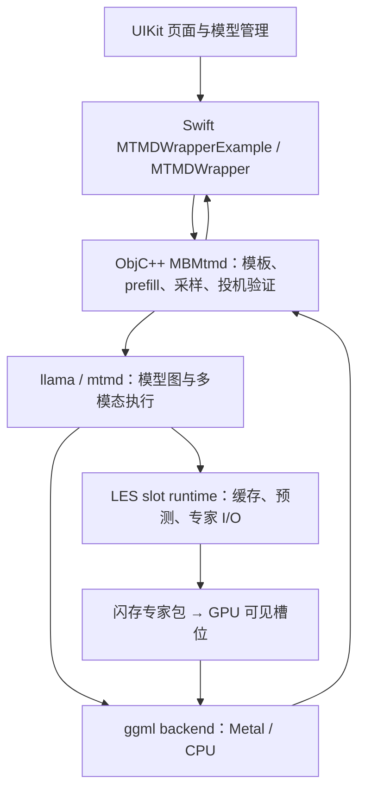

# iOS 第三方端侧推理架构与路线对比

- **日期：** 2026-11-13。
- **状态：** 架构调研与选型建议，尚未选定计算后端；关键实验待执行。
- **目标：** 按 [项目路线](../docs/14-roadmap.md)，从 OpenBMB 社区出发推进 LES 端侧效能；积极探索新技术，兼顾研究成果、真实使用价值与长期维护。
- **范围：** iOS 优先，以 MiniCPM-V 4.7 35B-A3B + LES 为主要评估对象，覆盖文字和单图问答。本文不启动正式后端实现。

实验进展：现有 1B 文字主干已在 Mac 完成有界生成；E1 动态专家与标准算子展开的循环状态通过 FP32 / FP16 对照，两个 FP16 小图已完成 iOS 目标编译。原生 GatedDelta 归一化出现数值偏差，iOS 真机执行仍 **[待实测]**。见 [转换与运行记录](coreai-export-experiment.md) 和[转换工作区](coreai/)；历史中间材料已清理，三条路线尚未定案。

## 先看结论

**推荐的开发方式：固定社区 LES 作为对照基线，先用最小实验验证 Core AI 的动态专家与混合状态路径，再决定计算控制权放在哪里。** 当前优先候选是保留 LES 成熟部分、引入 Apple 计算模块的混合实现；Core AI 中心实现继续作为可晋升的候选，不提前限制为“只能做视觉编码器”。

这个建议基于本轮核实的三点：

1. 社区实现已经提供专家 I/O、缓存、量化 Metal 内核与多模态流程，适合用作可运行的研究对照。但 App 桥和包装还包含模板、投机验证、日志与额外等待，不能只复制 UI 到 C 接口的几层代码。[C1] [C2] [C3]
2. Core AI 官方 `GatherMM` 示例允许把专家权重作为函数输入；官方优化库包含 3-bit palettization。[A4] [A5]
3. 官方 Qwen3.5 配方仍未支持 iOS；动态输入能否在 iOS 高效执行、如何沿用 Q3_K、跨层交接是否划算，尚需实验。现有文档足以安排小型可行性验证，尚不足以承诺完整重写的性能收益。[A3] [A4]

**下一项实验工作是 E1：iOS 最小算子、动态专家输入与循环状态真机验证。** 它不需要先下载完整 35B 权重。随后建立真机 LES 基线 E2；只有前两项给出可行路径与性能预算，再做 E3 的交接和专家格式实验。

## 1. 证据范围、版本与评估对象

“已核实”在本文指实际读取的官方文档或源码；源码注释中的设备经验单独说明。方案预期标为 **[推断]**，设备结果标为 **[待实测]**。

| 来源 | 本轮基线 | 说明 |
|---|---|---|
| 本地官方 App | `d0dd7a6074b950081d6303977efb646f2f85bb5b` | `refs/minicpm-v-apps`，只读；UI 是 UIKit，本项目骨架是 SwiftUI |
| 该 App 钉住的引擎 | `e0eca9d8f57ac8f5a5ad6191a8007b93436c1e71` | 嵌套子模块本地未初始化，读取固定提交的上游源码 |
| packed LES 对照树 | `ac765046581e07395fa6df39b7d4edc1b805ee71` | 与旧分支是分叉关系；API 和资产布局有变化 [V2] [V3] |
| `apple/coreai-models` | `acbce1b41f95955ab56597d11d94b447b16a80bd` | 模型配方、primitives 与 Swift 运行时 |
| `apple/coreai-torch` | `31908ce231d0794dd966f9fae610da5f95041288` | 转换工具与 composite op 文档 |
| `apple/coreai-optimization` | `78d22bef6d30e09997c06063cd2df24558e2b023` | 压缩配置源码 |
| Apple 公开文档 | 2026-11-13 读取 | API availability 与契约；仍需目标 SDK 核对 |

**主要评估模型（MiniCPM-V 4.7 35B-A3B + LES）：** `qwen35moe` 混合架构，共 40 层（仅 10 层带 KV，其余 30 层为 recurrent），每层 256 个专家、每 token 激活 top-8；Q3_K 混合精度下每个专家 1,351,680 B（约 1.29 MiB，每层分片约 330 MiB），总专家包约 12.9 GiB，主文件约 1.55 GiB，mmproj 约 1.04 GiB。[C7] 官方公开博客在 12 GB iPhone 18 Pro Max 上的消融参考为：按需读盘 `3.38` → 前瞻调度 `6.57` → 存取与布局优化 `11.34` → 混合精度 `17.16` → 完整 LES + DSpark `20.51 token/s`（M4 iPad Pro 约 `17.39`–`18.0 token/s`）。[B1]

源码链接均固定到上述提交。`ac76504` 中 `llama_model_params` 已移除旧 `moe_experts_path`，改由模型的 `les.moe.layout` 声明专家布局，`moe_slot_bank` 控制启用。研究基线必须成对固定 App 桥、引擎和资产，不能把这个分支当作旧桥的直接换库升级。[V2] [V3]

## 2. 先分清几个不同层次

| 层次 | 负责什么 | 本项目或参考实现 |
|---|---|---|
| UI / 产品规则 | 对话、下载状态、隐私同意、处理中断后的表现 | 本项目 SwiftUI + `MiniCPMCore` |
| 会话适配 | 消息与选项转换、流式事件、工具与结构化输出协议 | 本项目 `Engine`；可选 Foundation Models 适配 |
| 推理运行时 | 模型加载、tokenizer、模板、prefill、decode、状态与采样 | 社区 llama / mtmd，加上 App 桥中的部分逻辑 |
| LES 调度 | 专家槽位、预测、读盘、缓存淘汰、计算与 I/O 协作 | C++ 模型图、slot runtime；部分 DSpark 编排在桥中 |
| 计算 | 注意力、循环状态更新、矩阵运算与量化专家内核 | ggml Metal / CPU；候选 Core AI / Core ML |
| 模型资产 | 权重转换、量化、专家布局、校验与分发 | GGUF、mmproj、专家分片、草稿模型；候选 `.aimodel` |

### Apple 技术分别处在哪一层

- **Foundation Models：** 提供会话与生成接口。iOS 27 的 `LanguageModelExecutor` 明确可以桥接本地推理引擎或服务器 API。C++ LES 也能通过适配接入；它不接管专家缓存与算子执行。[A1]
- **Core AI：** iOS 27 起的模型转换、specialization、执行和调试体系；面向 CPU、GPU、ANE。可以直接 `AIModel → loadFunction → run/encode`，Foundation Models 是可选入口。[A2] [A13]
- **Core ML：** 已有的模型执行框架，能使用 CPU、GPU、ANE；仍有官方文档与应用场景。现有 Core ML 视觉资产可作为参考，选择 Core AI 时需要相应的转换与执行路径。[A10]
- **Metal：** 直接编程 GPU 的接口，负责 buffer、命令队列与计算内核。它为自定义专家计算提供控制权；ANE 通过模型框架调度。[A11]

Core AI 的 AOT 将部分 specialization 工作提前到构建机，生成按设备架构选择的 `.aimodelc`；官方文档说明加载时仍有 specialization。要分别测首次准备、缓存后加载与稳态推理，不能只用 AOT 名称推导 decode 提速。[A9]

本项目现有 `Engine` / `ModelStore` 是 UI 骨架的边界，继续用于产品层；需要的诊断能力由实验明确后再加。当前 `probe()` 返回设备概况，逐 token 调度测量需要其他入口。

## 3. 社区实现：一次请求实际怎么走

### 3.1 文字请求

1. **载入：** Swift 选择主 GGUF、mmproj、专家目录与可选草稿资产，计算内存档位与参数，经 `MTMDWrapper` 调 `mb_mtmd_init`。桥加载模型、context、sampler、batch 和视觉上下文。正常多模态模式即使当前只发文字也可能已加载视觉塔；`-moeTextOnly` 是单独的实验配置。[C1]
2. **Prefill（处理输入）：** 桥拼消息模板；纯文字路径 tokenize 后分批 `llama_decode`，多模态路径经 `mtmd_tokenize` 与 prefill helper。输入批次和单 token 解码都可能调用 `llama_decode`，阶段须由负载与调用位置识别。[C2]
3. **Decode（逐步输出）：** `mb_mtmd_loop` 采样并推进目标模型，DSpark 开启时可能经过草稿与验证循环。桥处理 UTF-8 字节，Swift 接回输出并刷新界面。[C3]
4. **结束与释放：** 回合 snapshot 会 park 专家内存而保留会话状态；清会话状态、切模型释放整个 context 是不同操作。Swift Task 取消不会中断已经进入的同步 native 调用，接入本项目时要串行管理取消与释放。[C3]

### 3.2 单图请求

选图 → 切片 / tokenize → 视觉编码 → 暂存 embedding → 发送时将图片 marker 与文字放在同一 user turn → 图文 prefill → decode。

V4.7 的 eager 路径会先缓存视觉 embedding，发送时再复用并写入语言模型状态；图片加入时的“已编码”和“已完成 LLM prefill”要分开计时。路径中还可发生专家预热、ubatch 重建与视觉资源卸载。[C4]

这为混合架构提供一个较清楚的候选边界：视觉执行器产出符合语言模型要求的 embedding，由既有运行时接管后续过程。是否选择这个边界，应由 E2 的时间分解决定；文本主干中的模块也可参与比较。

### 3.3 LES 的所有权与默认状态

| 能力 | 谁拥有 | 本轮核实的状态 |
|---|---|---|
| 前瞻预测 | C++ 模型图 + slot runtime | 用当前隐藏状态计算下一层 router；单 token 分支构建预测。App 默认预取深度 8 [C5] [C7] |
| 缓存窗口 | Swift 预算；C++ 管槽位与淘汰 | 有窗口时默认预读与主路径共享 `c+K` 统一 LRU；`LLAMA_MOE_PREFETCH_UNIFIED=0` 才退回分区 [C6] |
| 专家读取 | C++ I/O runtime | gate/up/down 连续区域一次 `preadv` 直接写槽位；有 dummy/skip 诊断模式 [C6] |
| 量化与布局 | 离线资产流程 + 对应计算内核 | 不是 Swift 开关。读取 Q3_K 专家包需要格式匹配的执行路径 |
| 就绪优先 A2 | C++ graph / slot runtime，桥传参数 | 当前按专家名次切分，App 默认 `matmul_split=0`；端上负收益是源码注释记录，尚未在本项目复现 [C8] |
| DSpark | C++ common 草稿模块 + ObjC++ 验证循环；Swift 管资产与策略 | 默认关闭，验证批宽按窗口夹紧；8 GB 设备的 4 GiB 限额是源码经验，实际设备与签名仍 **[待实测]** [C7] [C9] |
| ANE | 当前聊天路径无有效执行入口 | `coremlPath` 明确被忽略；模拟器走 CPU，真机请求 GPU。旧资产与导入框架不作为 ANE 基线 [C10] |

真实 router 仍决定执行的专家。改变专家数、量化或投机验证算法时，需单独记录质量影响；调度对比先保持模型、精度与真实 top-8 不变。

### 3.4 复用时必须显式处理的边界

以下是参考实现的观察，作为基线与接入清单，不在本轮修改上游：

- **计时：** Swift 生成循环存在每次约 10 ms 的 `Task.sleep`，UI 输出另有 50 ms 节流；图片显示耗时还有固定补值。分别保留 native 内核计时、请求墙钟和 UI 首字时延，不用设置页数字代替完整测量。[C3] [C11]
- **日志：** 桥将完整 prompt / 输出写入 Documents 文件及 NSLog。研究仅使用公开或合成输入；正式集成须符合本项目隐私与临时对话规则。[C12]
- **生命周期：** 在途 native 调用与 context 释放需要明确的完成边界，不能只取消 Swift Task 就立即释放。当前 reset 路径需在接入时验证。[C3]
- **升级：** 桥手写 DSpark 公共结构体布局，依赖对应 libcommon ABI；引擎、桥与资产一起固定版本。[C12]
- **许可：** App 与引擎为 MIT，保留版权与许可；App LICENSE 明确不覆盖下载权重。`coreai-models` 为 BSD-3-Clause。模型资产、工具依赖和品牌授权分别处理。[L1] [L2]

## 4. Apple 能力：哪些已证实，哪些仍需实验

| 问题 | 一手证据与判断 | 对路线的影响 |
|---|---|---|
| 官方 Qwen3.5 能否直接导出 iOS？ | 配方表包括 35B-A3B，均列 macOS 27.2+、iOS No；导出器缺少 `ios_class` 时显式拒绝 [A3] [A14] | 必须补 iOS 配方；先测试最小算子，避免从完整模型开始 |
| 专家能否是运行时输入？ | `GatherMM` 示例是 `forward(x, experts, indices)`；官方 `SwitchLinear` 默认把整组专家作为 Parameter 是另一种写法 [A4] [A15] | 可以研究固定容量槽位作为输入，iOS 执行效率仍 **[待实测]** |
| 编译常量能否热替换？ | 本轮读取的公开接口未找到加载后替换编译常量的契约 | 候选方案使用显式输入或图外专家执行，不依赖未证实的常量替换 |
| 动态输入是否直接兼容 Q3_K？ | `GatherMM` 文档列浮点 operand；未发现原生消费 GGUF Q3_K 专家字节的契约 [A4] | 须验证解量化与临时浮点槽位成本，或复用量化 Metal 内核 |
| 有没有 3-bit？ | `PalettizationSpec.n_bits` 包含 3；这是 LUT 压缩，非 Q3_K [A5] | 可以研究重压缩；不能假定沿用权重字节、iOS 性能或质量 |
| 能否图中调 CPU 读专家？ | 本轮公开 `InferenceFunction` / `ComputeStream` 与转换资料未找到任意 host callback 契约 | 当前可设计多函数、图外调度；交接成本进入 E3，框架全局不支持的结论仍未证实 |
| 能否共享 Metal 内存？ | `AsyncValue(unsafeBuffer:)` 直接引用 shared `MTLBuffer`；使用期间不得改写 [A6] | 输入可共享；I/O 写入、计算完成与槽位复用必须同步，内部布局转换仍需测量 |
| 能否混编自写 GPU 计算？ | `ComputeStream(commandQueue:)` 可用自有队列，推理按数据依赖串行化；`TorchMetalKernel` 可嵌入内核但其底层 authoring API 标为实验性 [A7] [A8] | 区分图外标准 Metal 与图内实验性扩展，各自评估维护成本 |
| 指定 ANE 是否保证全图上 ANE？ | `preferredComputeUnitKind` 是 specialization 偏好；不兼容算子或融合模式可回退 [A12] | 必须跟踪实际 placement、转换和能耗，按函数 / 资产拆分仅是候选设计 |

**核心剩余问题是组合能力。** 显式专家输入、共享 buffer 和低位压缩分别有证据；“动态压缩槽位 + iOS 高效算子 + 低成本跨层调度”这一组合尚未得到运行结果。

官方 Qwen3.5 配方携带 `keyCache`、`valueCache`、`convStates`、`recurrentStates`，可作为混合状态的实现参考。[A3] E1 应检查连续多个 step 的状态更新，而非只计算一次矩阵乘法。

## 5. 三条路线：改变的是谁控制推理

下表的 A/B/C 与路线文档的阶段字母无关，仅作为候选标识。

| | A：社区 LES 深度演进 | B：Apple 混合实现 | C：Core AI 中心实现 |
|---|---|---|---|
| 控制权 | llama / 社区运行时拥有 token 与层循环、模型状态 | 社区运行时保有主循环，明确模块交给 Apple 执行器 | Swift / 新运行时拥有层循环与状态，Core AI 执行主要函数，LES 在图外协作 |
| 主要复用 | 专家包、I/O、缓存、模型图、量化内核、mtmd | A 的必要部分，加 Apple 转换与执行设施 | 模型定义与转换参考；可继续复用 C++ I/O 或 Metal 专家内核，不要求纯 Swift |
| 自研边界 | 本项目适配器、生命周期、诊断和经测量选出的 LES 改进 | 模块资产、数据布局、状态与跨执行器同步 | iOS 混合 MoE 配方、状态管理、LES 编排、压缩路径、采样与多模态集成 |
| 预期成果 **[推断]** | 调度 / 内存 / I/O 改进，较易与社区直接对照与回馈 | Apple 硬件利用与 LES 的协同方法，模块级能效或时延成果 | 新的 Apple 平台 LES 执行架构与配方，技术探索空间最大 |
| 主要代价 | 继续承担 ggml / 桥的版本演进；硬件能力利用取决于具体内核 | 两套执行体系、资产与交接成本；不能假定模块换掉就更快 | 更大状态与算子维护面；动态专家和量化可能抵消编译优化收益 |
| 最强反对证据 | 社区 App 默认策略和包装计时尚不能直接呈现全部 LES 收益 | 模块交接可能增加复制和同步，实际瓶颈也可能在未替换部分 | 官方 iOS 配方缺失，Q3_K 接入未证实，层间编排尚无测量 |
| 进入条件 | E2 找到值得改善的实际瓶颈 | E2 定位边界，E1 / E3 验证相关模块 | E1 可执行，E3 显示状态 / 格式 / 编排有可行预算，再推进小段真实模型 |

### 推荐及其边界

**当前优先候选是 B，开发过程采用“共同基线 + 单线递进实验”。** 它允许复用已经实现的 LES 动态存储能力，把研发投入放在 Apple 平台可贡献的新边界；具体模块由测量决定，视觉塔和文本主干都保留选择空间。

选择 B 的理由是现有可复用的 I/O 与量化实现，以及 Apple 侧尚未覆盖的 iOS 配方与组合能力。这个理由会被 E1 / E3 的结果改变：

- E1 与 E3 若显示动态专家、状态和编排可有效组合，优先推进 C 的真实层片段，再决定是否将控制权转到新运行时。
- 仅局部计算得到收益时，继续 B，保留社区主循环。
- Apple 路径在目标负载无收益或缺口过大时，采用 A 深化 LES 调度，明确成果仍可来自现有运行时。

跨平台共享优先考虑算法、资产语义、测量方法和可移植实现。iOS 获得新的计算路径后，再评估其他平台复用范围，不先要求所有平台同一个后端。

## 6. 最多三个关键实验

以下为实验设计；E1 的 Mac 与目标编译进展见 [实验记录](coreai-export-experiment.md)，真机部分及 E2 / E3 仍 **[待实测]**。只使用公开 / 合成数据；实验代码放在 `refs/` 之外。结果记录设备、OS / SDK、签名与 entitlements、工具 / 引擎提交、模型或输入摘要、构建配置及原始计时。先不建设通用基准面板。

### E1：iOS 能否执行最小动态专家与混合状态路径（下一项）

- **假设：** 官方 iOS 配方的缺口可以用公开 Core AI 接口补齐；固定容量专家输入可在两次执行间更新，循环状态可连续演进。
- **实现参考：** 官方 `GatherMM`、`GatedDeltaUpdate` 示例与 Qwen3.5 状态定义。[A3] [A4] [A16] 先用小形状与 FP32 / FP16，移除压缩和完整模型下载的干扰。
- **输入与对照：** 固定 seed 的隐藏状态、top-k ids、两份不同专家张量；运行 W1，等待完成后换 W2，再运行 W1。与相同 dtype 的 PyTorch 数学参考比较。随后加入最小 Gated Delta / conv 状态片段，连续执行多个 step，对照输出与最终状态。
- **设备与签名：** 在 Mac 固定工具版本，确认目标 iOS SDK / Metal Toolchain；真机执行 GPU 路径，模拟器只作接口检查。这个小实验不依赖 increased-memory-limit，实际签名与运行情况照实记录。
- **观测：** 转换、specialization、加载、执行在哪一步成功或失败；输出误差、状态变化、是否重编译 / 重新加载、峰值内存和实际执行单元。数值容差按 dtype 与参考误差制定，不要求跨运行时逐字节一致。
- **停止条件：** 小形状可稳定更新权重与状态即可结束，暂不扩完整层。失败时保留完整错误，区分配方、lowering、specialization 与设备执行；不以重复加载整个模型或私有补丁掩盖动态路径失败。
- **结果如何改变路线：** 两部分均通过，C 进入 E3；仅某模块通过，B 按可执行模块评估；原生路径失败时，先判断一个局部 Metal 实现能否补齐，超出局部缺口则停止本轮 Core AI 中心原型。

### E2：同一台 iOS 设备上的 LES 基线与时间分解

- **假设：** 能将专家 I/O、计算、调度与 App 包装开销分开，找到值得改变的边界。
- **基线：** 成对固定 `d0dd7a6 + e0eca9` 或经核实的 `99bfa54 + 0c0b110`、拆分 LES 资产及校验信息。保持真实 top-8、相同精度、上下文、种子与生成上限。先用默认预算、DSpark 关；只在可用内存允许时加一组 `c` 对照。
- **负载：** 短文字、较长文字各生成固定上限 token；单图固定分辨率 / 切片与提示。固定 tokenizer 后记录实际 token 数。冷加载单独列，稳态至少三次报告中位数与范围；若输出提前结束则记录，不把短样本混入固定长度结果。
- **执行入口：** 真机 App 调试 harness 分别测参考包装和直接 native 驱动，使用相同引擎与资产；长链路基线不使用模拟器 CPU 数据。Instruments Time Profiler / Metal 跟踪加必要 signpost 即可。
- **观测：** 端到端首字、图片编码、LLM prefill、native decode 与请求墙钟吞吐、读取字节、缓存命中、峰值 footprint / Metal 分配。原有 10 ms 等待与图片显示补值在结果中单列；能耗仅在工具可归因时报告，并说明来源与单位。
- **设备与签名：** 从实际可用的一台 iOS 真机开始；记录物理内存、`os_proc_available_memory`、签名与权限，不预设免费签名可达到公开高档位。受限时记录可运行配置，不扩大为所有设备结论。
- **停止条件：** 获得稳定基线和主要时间块即可；暂不扫所有 `c/K/n_max`。有需要时使用 skip-read 诊断分离 I/O，错误输出样本明确排除质量与正常吞吐结果。
- **结果如何改变路线：** I/O / 缓存占主要关键路径则 A 优化价值高；某个可独立模块占用显著且 Apple 可执行则 B 优先替换；已有层交接与状态成本为 E3 提供预算。

### E3：真实形状下，Apple 模块与 LES 的交接和格式成本是否划算

- **前置：** E1 给出可执行模块，E2 给出目标设备的时间与内存基线。只选一个边界，不同时开发视觉、全部主干和专家库。
- **假设：** 相同工作量下，Core AI 模块的计算收益能覆盖交接、状态、格式转换和调度成本。
- **对照：** 从同一模型取一个真实形状层片段或视觉边界，对照原 ggml 执行。两条路径使用相同输入、状态和权重值；先做内存常驻对照，涉及专家时再重放同一段路由 / miss 轨迹加入 I/O。
- **专家格式：** 初始沿用 Q3_K 源包。对比直接量化 Metal 路径，以及解量化到浮点槽位后给 Core AI 的路径，记录临时槽位、解量化、布局与重读成本。只有必要时再研究原生压缩；改 palettization 时单独列质量与资产变化，不将位数相同视为格式相同。
- **同步：** 明确 shared buffer 的写入完成、推理完成与槽位再用时点；用同一 `ComputeStream` / Metal 队列能表达的依赖，CPU 路由与 I/O 交接另测。用实际 trace 检查复制、重排与 GPU 空隙。[A6] [A7]
- **预算：** 对每个被替换边界比较新旧路径的墙钟时间，并用 trace 分解新计算、交接、格式转换与新增等待在关键路径上的不可重叠部分，避免重复累加已重叠的工作。新路径需在重复测量波动之外更快，或在约定可接受时延内取得可重复的能耗 / 内存优势。按真实调用次数汇总，不沿用每层 0.3 ms 等固定门槛。
- **设备与签名：** 与 E2 同机同签名同负载。Mac 可先调通机制，iOS 性能单列；ANE 方案要报告实际 placement、可用能耗指标和转换成本。
- **停止条件：** 同一边界在真实形状获得稳定正负结果即可。失败不扩整模型；收益依赖重新编译每个专家或超出设备内存时，结束该动态方案。
- **结果如何改变路线：** 局部收益支持 B；层级动态专家与状态也有余量时推进 C 的短层链；交接 / 解量化吃掉收益则保留 A，或回到更粗粒度的 B 边界。

### 实验后怎么作决定

| 结果 | 下一步 |
|---|---|
| E1 核心算子或状态失败，补齐需要大规模私有修改 | 收敛到 A 或可执行局部的 B，记录未满足需求与重启条件 |
| E1 通过，E3 仅粗粒度模块有收益 | 选择 B，明确模块边界、资产与状态所有权 |
| E1 通过，E3 动态专家 / 层链也有收益与内存余量 | 推进 C 的小段真实模型端到端验证，再决定完整迁移 |
| E2 揭示更大的 LES 调度瓶颈 | 优先 A 的针对性改进；Apple 研究按已发现的需求缩小 |

实验结论连同接受的研发 / 维护代价写回 [决策记录](../docs/10-decisions.md)。之后才安排正式 `Engine` 接入、完整模型支持和功能开发。

## 7. 一手来源与实现入口

### 社区代码与公开基准

- [B1]：官方博客《LES：让 35B MoE 在手机上实时无损运行》（2026-10-20）。
- [C1]：`MBHomeViewController+LoadModel.swift` L289–389；`MBMtmd.mm` L1787–2031 为 native 初始化入口。
- [C2]：`MBMtmd.mm` L2551–2781，文字模板与 prefill。
- [C3]：`MTMDWrapper.swift` L480–696，生成、取消后的行为、计时和释放；native loop 为 `MBMtmd.mm` L3047–3146。
- [C4]：`MBMtmd.mm` L2394–2545，eager image embedding；L1182–1463 为图文 prefill helper。
- [C5]：`qwen35moe.cpp` L451–468，下一层路由预测。
- [C6]：`llama-moe-slot.cpp` L1090–1189 为窗口与统一 LRU；L1437–1502 为读取及诊断入口。
- [C7]：`MiniCPMModelConst.swift` L513–575、L618–774、L1090–1097，DSpark、预算、预取默认值。
- [C8]：`MBMtmd.mm` L835–858，A2 默认关闭；对应 graph 在引擎 `src/llama-graph.cpp` L1641–1702。
- [C9]：`MBMtmd.mm` L2855–3045，投机验证。
- [C10]：`MTMDWrapperExample.swift` L158–211，忽略 Core ML 路径与模拟器 / 真机差异。
- [C11]：`MBHomeViewController+ImageProcess.swift` L132–140，图片显示计时补值。
- [C12]：`MBMtmd.mm` L40–250，文本日志与 DSpark ABI 定义。
- [V2]：LES 分支 compare；[V3] 为 packed 格式与迁移说明。
- [L1]：社区 App LICENSE（包含子模块与权重许可边界）。

### Apple 文档与代码

- [A1]：`LanguageModelExecutor` 官方协议与本地 / 远程适配职责。
- [A2]：Core AI 官方概览；[A13] 为直接加载和运行函数的集成示例。
- [A3]：Qwen3.5 模型支持表与四类状态；[A14] 为导出器 iOS 分支检查。
- [A4]：官方 `GatherMM` 动态专家输入示例、dtype 与 export；[A15] 为默认常量专家配方。
- [A5]：`PalettizationSpec` L105，支持的位数。
- [A6]：shared `MTLBuffer` 输入与手动同步责任。
- [A7]：`ComputeStream` 及自有 Metal 队列入口。
- [A8]：`TorchMetalKernel` API 与实验性声明。
- [A16]：`GatedDeltaUpdate` 的状态输入 / 输出、dtype 与参数约束；数学参考注意 `g` 为负、算子内部取 `exp`。
- [A9]：Core AI AOT 编译、资产下载与设备端 specialization。
- [A10]、[A11]：Core ML、Metal 的官方概览。
- [A12]：计算单元偏好与回退语义。
- [L2]：`coreai-models` BSD-3-Clause 许可。

[B1]: https://openbmb.cn/blog/les-35b-moe-on-device-real-time
[C1]: https://github.com/OpenBMB/MiniCPM-V-Apps/blob/d0dd7a6074b950081d6303977efb646f2f85bb5b/MiniCPM-V-demo/Sources/Home/ViewController/MBHomeViewController%2BLoadModel.swift#L289-L389
[C2]: https://github.com/OpenBMB/MiniCPM-V-Apps/blob/d0dd7a6074b950081d6303977efb646f2f85bb5b/MiniCPM-V-demo/MTMDWrapper/Bridge/MBMtmd.mm#L2551-L2781
[C3]: https://github.com/OpenBMB/MiniCPM-V-Apps/blob/d0dd7a6074b950081d6303977efb646f2f85bb5b/MiniCPM-V-demo/MTMDWrapper/MTMDWrapper.swift#L480-L696
[C4]: https://github.com/OpenBMB/MiniCPM-V-Apps/blob/d0dd7a6074b950081d6303977efb646f2f85bb5b/MiniCPM-V-demo/MTMDWrapper/Bridge/MBMtmd.mm#L2394-L2545
[C5]: https://github.com/tc-mb/llama.cpp-omni/blob/e0eca9d8f57ac8f5a5ad6191a8007b93436c1e71/src/models/qwen35moe.cpp#L451-L468
[C6]: https://github.com/tc-mb/llama.cpp-omni/blob/e0eca9d8f57ac8f5a5ad6191a8007b93436c1e71/src/llama-moe-slot.cpp#L1090-L1189
[C7]: https://github.com/OpenBMB/MiniCPM-V-Apps/blob/d0dd7a6074b950081d6303977efb646f2f85bb5b/MiniCPM-V-demo/Sources/Settings/ModelConst/MiniCPMModelConst.swift#L513-L575
[C8]: https://github.com/OpenBMB/MiniCPM-V-Apps/blob/d0dd7a6074b950081d6303977efb646f2f85bb5b/MiniCPM-V-demo/MTMDWrapper/Bridge/MBMtmd.mm#L835-L858
[C9]: https://github.com/OpenBMB/MiniCPM-V-Apps/blob/d0dd7a6074b950081d6303977efb646f2f85bb5b/MiniCPM-V-demo/MTMDWrapper/Bridge/MBMtmd.mm#L2855-L3045
[C10]: https://github.com/OpenBMB/MiniCPM-V-Apps/blob/d0dd7a6074b950081d6303977efb646f2f85bb5b/MiniCPM-V-demo/MTMDWrapper/MTMDWrapperExample.swift#L158-L211
[C11]: https://github.com/OpenBMB/MiniCPM-V-Apps/blob/d0dd7a6074b950081d6303977efb646f2f85bb5b/MiniCPM-V-demo/Sources/Home/ViewController/MBHomeViewController%2BImageProcess.swift#L132-L140
[C12]: https://github.com/OpenBMB/MiniCPM-V-Apps/blob/d0dd7a6074b950081d6303977efb646f2f85bb5b/MiniCPM-V-demo/MTMDWrapper/Bridge/MBMtmd.mm#L40-L250
[V2]: https://api.github.com/repos/tc-mb/llama.cpp-omni/compare/0c0b1109f2d338acf65f28a7b0a1505da3945286...ac765046581e07395fa6df39b7d4edc1b805ee71
[V3]: https://github.com/tc-mb/llama.cpp-omni/blob/ac765046581e07395fa6df39b7d4edc1b805ee71/docs/les/les-gguf-format.md#L180-L203
[L1]: https://github.com/OpenBMB/MiniCPM-V-Apps/blob/d0dd7a6074b950081d6303977efb646f2f85bb5b/LICENSE
[A1]: https://developer.apple.com/documentation/foundationmodels/languagemodelexecutor
[A2]: https://developer.apple.com/documentation/coreai
[A3]: https://github.com/apple/coreai-models/blob/acbce1b41f95955ab56597d11d94b447b16a80bd/models/qwen3_5/README.md#L20-L33
[A4]: https://github.com/apple/coreai-torch/blob/31908ce231d0794dd966f9fae610da5f95041288/docs/api/composite-ops/gather-mm.md#L78-L116
[A5]: https://github.com/apple/coreai-optimization/blob/78d22bef6d30e09997c06063cd2df24558e2b023/src/coreai_opt/palettization/spec/spec.py#L105
[A6]: https://developer.apple.com/documentation/coreai/inferencefunction/asyncvalue/init(unsafebuffer:byteoffset:scalartype:shape:strides:interleavelayout:)
[A7]: https://developer.apple.com/documentation/coreai/computestream
[A8]: https://github.com/apple/coreai-torch/blob/31908ce231d0794dd966f9fae610da5f95041288/docs/api/TorchMetalKernel.md#L1-L7
[A9]: https://developer.apple.com/documentation/coreai/compiling-core-ai-models-ahead-of-time
[A10]: https://developer.apple.com/documentation/coreml
[A11]: https://developer.apple.com/documentation/metal
[A12]: https://developer.apple.com/documentation/coreai/specializationoptions/preferredcomputeunitkind
[A13]: https://developer.apple.com/documentation/coreai/integrating-on-device-ai-models-in-your-app-with-core-ai
[A14]: https://github.com/apple/coreai-models/blob/acbce1b41f95955ab56597d11d94b447b16a80bd/python/src/coreai_models/export/pipeline.py#L245-L246
[A15]: https://github.com/apple/coreai-models/blob/acbce1b41f95955ab56597d11d94b447b16a80bd/python/src/coreai_models/primitives/macos/switch.py#L22-L45
[L2]: https://github.com/apple/coreai-models/blob/acbce1b41f95955ab56597d11d94b447b16a80bd/LICENSE
[A16]: https://github.com/apple/coreai-torch/blob/31908ce231d0794dd966f9fae610da5f95041288/docs/api/composite-ops/gated-delta-update.md#L28-L80
