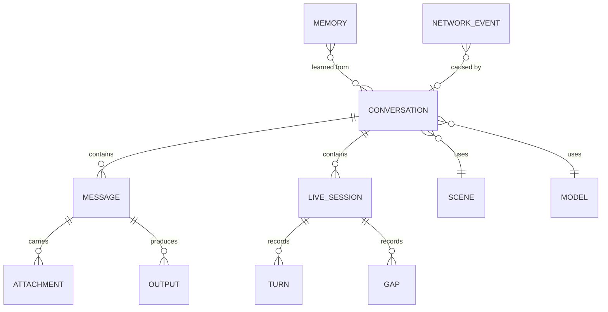
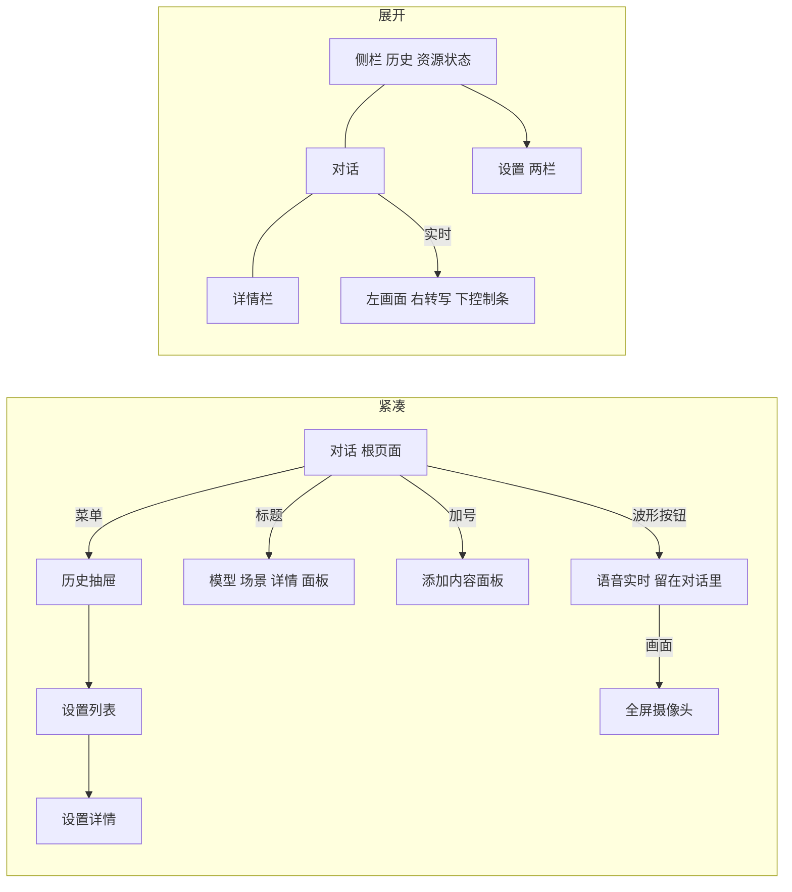
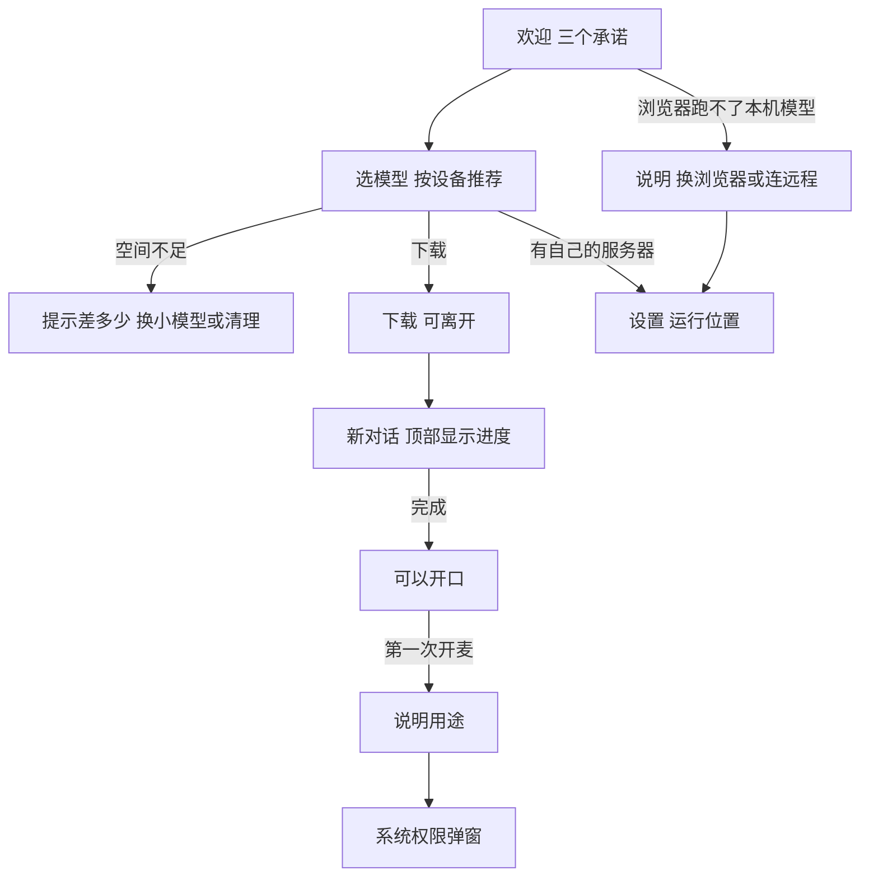

# 信息架构

本文定义产品里有哪些东西、它们怎么组织、用户怎么走。原生端的路由和数据模型从这里开始。

## 对象模型



| 对象 | 用户叫它 | 说明 |
|---|---|---|
| Conversation | 对话 | 唯一的顶层容器。可以是临时对话 |
| Message | 消息 | 用户消息或模型回答。回答可以带步骤、语音、产物 |
| Live session | 实时会话 | 对话里的一个块。进行中是控制条，结束后折叠成记录 |
| Turn | 话轮 | 实时里的一段话。标记主动提醒、被打断、说到一半暂停 |
| Gap | 空白 | 实时里系统造成的中断记录，比如来电和断线 |
| Scene | 应用场景 | 决定建议、主动提醒频率和可用能力。用稳定 ID，显示名单独存 |
| Model | 模型 | 下载到设备上的文件。一次只运行一个，所有对话共用 |
| Memory | 已记住的内容 | 跨对话的偏好，逐条可删 |
| Output | 产物 | 对话生成的文件 |
| Network event | 联网记录 | 设备发出的每一类请求 |

场景的 ID 是 `life`、`work`、`game`、`community`，显示名是生活助手、工作助手、游戏助手、社区助手。翻译和后续分发都只动显示层。

“任务”一词只留给定时任务和开发者页面。普通界面统一叫“对话”。

## 一套结构，两种形态

形态由窗口尺寸决定，不由设备类型决定。iPad 分屏和缩小的 Mac 窗口都可能是紧凑形态。

| 形态 | 条件 | 结构 |
|---|---|---|
| 紧凑 | 窗口宽 < 600，或高 < 480 | 对话是根页面，历史是抽屉或侧滑，菜单是底部面板，设置是列表进详情 |
| 中等 | 宽 600–839 | 同紧凑，内容区加宽；原型按紧凑处理 |
| 展开 | 宽 ≥ 840 | 侧栏 + 对话 + 可选详情栏，菜单是弹出菜单，设置是两栏 |

原型目前的断点是 820px，落地时按平台断点走。



## 根页面

打开应用时默认是一个新对话，可以直接开口。设置里可以改成“上次的对话”。

| 区域 | 紧凑 | 展开 |
|---|---|---|
| 顶部 | 菜单、标题（模型名和处理位置）、新对话或临时对话 | 标题、场景、详情开关 |
| 中部 | 提问语和隐私声明 | 同左，加场景选择 |
| 底部 | 建议（横向滚动）、输入框 | 输入框、建议（三列） |
| 侧栏 | 无 | 新对话、搜索、历史、资源状态、设置 |

**紧凑形态的右上角**：空白对话时是临时对话开关，有内容后是新对话。空白对话里“新对话”没有意义，这个位置留给更有用的动作。

## 输入框

输入框是用户的主要入口。把它的控件按使用频率分三层：

| 层 | 控件 |
|---|---|
| 一直可见 | 添加、文字、语音消息、实时（有内容时变成发送） |
| 展开形态可见，紧凑形态收进加号面板 | 语音回复、深度思考 |
| 展开形态可见，紧凑形态收进标题面板 | 模型 |

紧凑形态开启深度思考或语音回复时，输入框上方出现可关闭的标记，避免模式被藏起来。

## 实时入口

| 入口 | 行为 |
|---|---|
| 输入框的波形按钮 | 紧凑形态直接开始语音；展开形态选来源 |
| 建议 | 按建议的来源开始 |
| 加号面板 | “实时看”打开摄像头 |

控制条的结构见 [实时会话](04-live-session.md)。

## 设置

设置保持完整，用来验证设计。分组按用户想做的事，不按系统架构。

```
设置
├─ 通用            外观、语言、文字大小、打开时、提示音
├─ 声音与人设      声音、语速、回答语言和长度、称呼、人设
├─ 实时会话        主动提醒、打断灵敏度、自动暂停、字幕、设备
├─ 模型            当前模型、运行方式、电量与发热、运行位置
├─ 隐私与数据      联网、记录、记忆、实时、权限、访问、数据
│   ├─ 已记住的内容
│   └─ 联网记录
├─ 应用场景        场景开关、每个场景的主动提醒
└─ 高级            回答参数、设备参数、显示技术信息
    └─ 开发者      Agents、Skills、资源服务
```

高级设置是唯一出现参数名的地方。

## 当前模型

本机很难同时运行多个模型，所以模型属于整个应用，不属于某个对话。运行位置和当前模型是全局的两个状态，所有对话共用。

| 项目 | 规则 |
|---|---|
| 切对话 | 不换模型，也不触发载入。旧对话用当前模型继续 |
| 选模型 | 点一下不会换。行下方就地展开一句说明和“换用”“先不换”，写明影响所有对话和大约要等多久。点别处等于不换。设置里的“换用”相同 |
| 确认后 | 立刻开始换 |
| 换的过程 | 横幅写“正在换到 X”和预计时间，可以取消。可以继续打字，发送后自动接上 |
| 取消 | 换回原来的模型，可能也要等一会 |
| 载不下 | 换回原来的模型，横幅写明内存不够，给重试 |
| 回答生成中 | 不换，提示“这条回答还没结束”，给“停止并换” |
| 实时进行中 | 不能换，结束后才行 |
| 需要别的模型 | 先问，不自动换。比如视觉模型下开始实时，说明要换成谁、要等多久，点“换用并开始”。下载了全能模型才显示实时入口 |
| 定时任务 | 用当前模型。能力不够时跳过，在对话里留一行说明，不抢占 |
| 空闲释放内存后 | 下次使用走同一条载入路径 |
| 回答记录 | 记下是哪个模型答的，打开“显示技术信息”后可见 |
| 远程服务 | 规则相同，只是没有载入等待 |

## 运行位置

模型在哪里跑只有两个选项，四端相同：

| 选项 | 含义 | 内容去向 |
|---|---|---|
| 这台设备 | 原生应用里是本机引擎，Web 上是这个浏览器（WebGPU），包括 Windows 和 Linux | 不离开本机 |
| 远程服务 | 用户自己配置的服务器 | 发送到写明的地址 |

**入口**：模型选择器里有运行位置（桌面的模型菜单、手机的标题面板），一步切换。完整配置在“设置 > 模型 > 运行位置”。

**规则**：

- 运行位置是全局的，切换后下一条消息生效，对话记录始终留在本地。
- 没配置过远程时，选远程直接进入设置并聚焦地址栏。没填完之前横幅提供“改用这台设备”。
- 切换时内容还没有离开，所以不弹确认，只给提示和撤销。已有内容的对话提示“这个对话的上文也会发送到 example.com”。
- 第一条走新位置的消息或实时会话之前，对话里留一行标记，比如“从这里开始发送到 example.com 处理，上文也包括在内”。
- 实时会话进行中不能切换。
- 运行位置只由用户改变。一边失败时，横幅提供另一边的按钮，由用户点。

**浏览器的差异**：

| 情况 | 设计 |
|---|---|
| 模型存放 | 在这个浏览器里，欢迎流程和模型设置写明清除网站数据时会一起删除 |
| 被浏览器清掉 | 走“还没有这个模型”的路径，横幅写“这个浏览器里还没有” |
| 浏览器跑不了 | 横幅说明并给“改用远程服务”。首次使用时选模型页换成同样的说明 |
| 读不到硬件 | 只显示可用空间，负载显示读不到 |
| 平台没有的设置 | 隐藏开机启动、关闭窗口、打开时验证、自动锁定、禁止截屏、加密保存，以及本地服务地址和显卡加速层数 |

## 主要流程

### 第一次使用



权限不在欢迎流程里一次要完，在用户第一次用到时再问。这时用户知道为什么需要它。

### 一次实时会话

开始 → 连接 → 聆听 ⇄ 说话 ⇄ 回应 → 结束或转文字 → 记录留在对话里 → 文字继续，带上记录。

完整状态见 [实时会话](04-live-session.md)。

### 临时对话

空白对话里打开临时开关 → 标题变成“临时对话”，输入框边框变虚线 → 离开后清除，不进历史，不写入记忆。设置里可以把它设成默认。

清除没有撤销，这是临时对话的承诺。

### 联网查询

模型判断需要联网 → 对话里出现询问卡片，写明要发送的那句话 → 用户点“查一下”才发送 → 对话里留下一行记录，联网记录页增加一条。

设置里的“联网搜索”有三档：关闭、每次询问（默认）、自动。离线模式覆盖全部。

### 从系统进入

这些入口不在网页原型里，原生端需要设计，见 [平台落地](07-platforms.md)：

- 分享到 MiniCPM：从相册或文件分享一张图，打开新对话并带上附件。这是“看懂这张单据”最自然的入口。
- 快捷指令和语音入口：直接开始语音或摄像头实时。
- 通知：定时任务结果和主动提醒。
- 菜单栏（macOS）：常驻、快速提问、实时状态。
