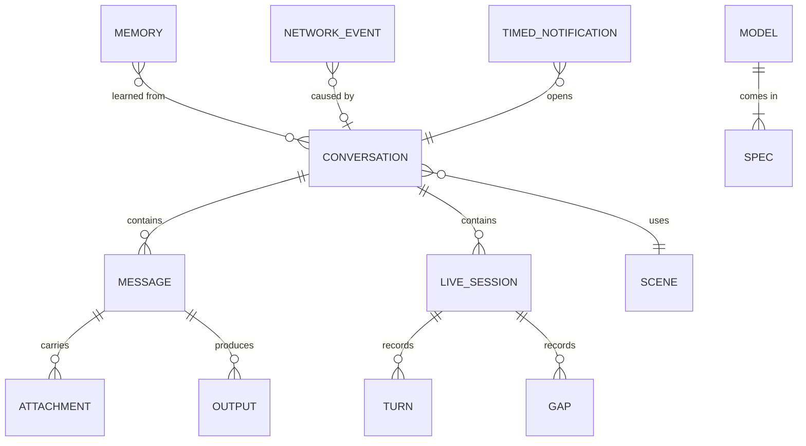
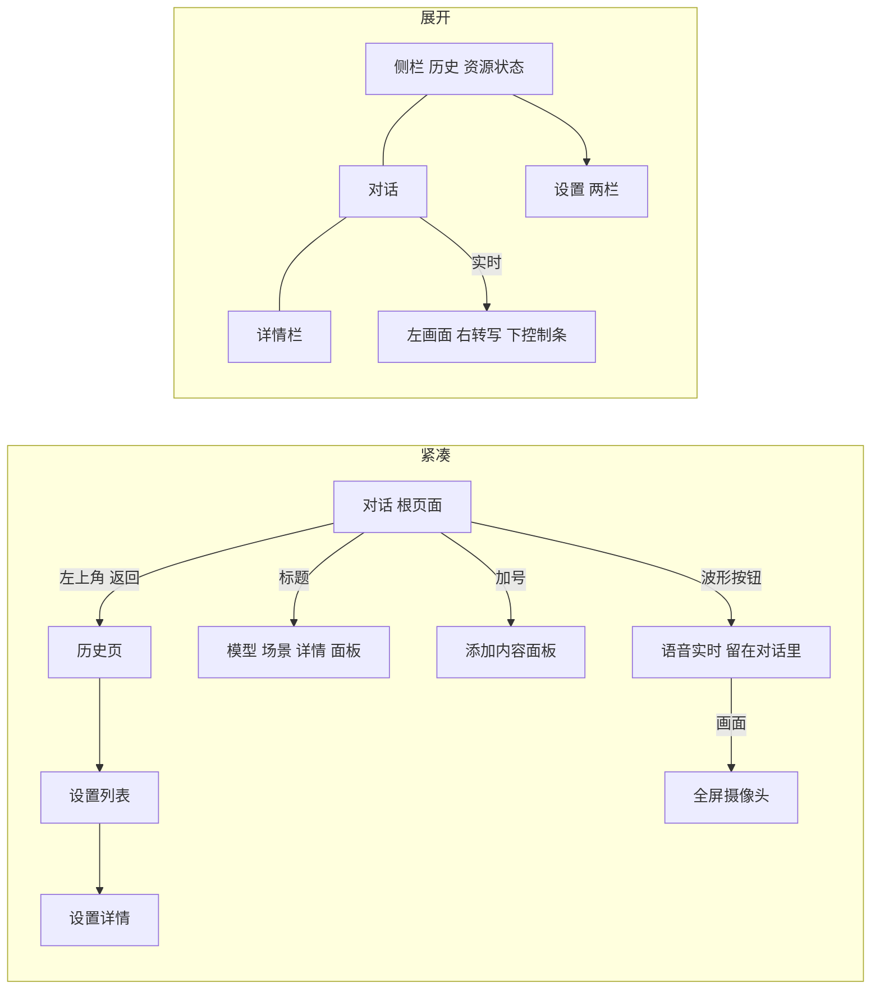
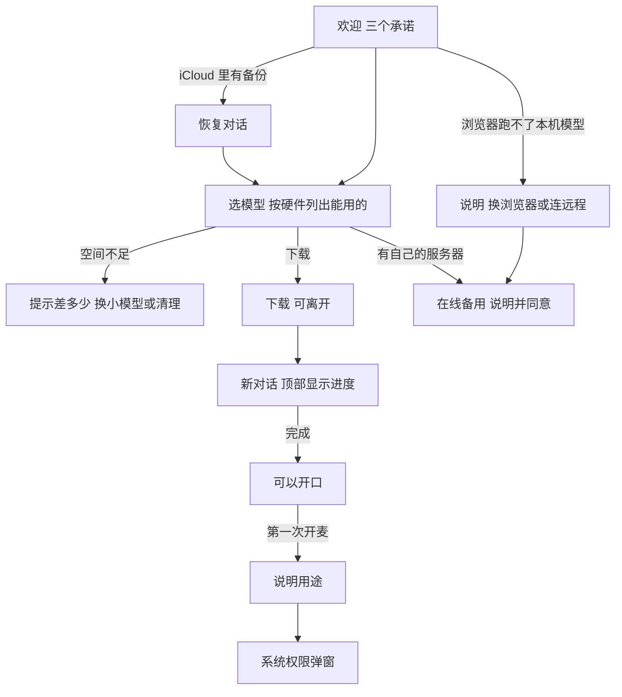

# 信息架构

本文定义产品里有哪些东西、它们怎么组织、用户怎么走。原生端的路由和数据模型从这里开始。

## 对象模型



| 对象 | 用户叫它 | 说明 |
|---|---|---|
| Conversation | 对话 | 唯一的顶层容器。可以是临时对话 |
| Message | 消息 | 用户消息或模型回答。回答可以带步骤、语音、产物 |
| Live session | 实时会话 | 对话里的一个块。进行中是控制条，结束后折叠成记录 |
| Turn | 话轮 | 实时里的一段话。标记主动提醒、被打断、说到一半暂停 |
| Gap | 空白 | 实时里系统造成的中断记录，比如来电和断线 |
| Scene | 应用场景 | 决定建议、主动提醒频率和可用能力。用稳定 ID，显示名单独存 |
| Model | 模型 | 下载到设备上的文件。一次只运行一个，所有对话共用 |
| Spec | 规格 | 同一个模型的不同精度，比如轻量（Q4）和完整（F16）。一个模型只留一种规格 |
| Memory | 已记住的内容 | 跨对话的偏好，逐条可删 |
| Output | 产物 | 对话生成的文件 |
| Network event | 联网记录 | 设备发出的每一类请求 |
| Timed notification | 定时通知 | 系统到点发出的通知，点开回到对话。模型不运行 |

场景的 ID 是 `life`、`work`、`game`、`community`，显示名是生活助手、工作助手、游戏助手、社区助手。翻译和后续分发都只动显示层。

“任务”一词只留给开发者页面。普通界面统一叫“对话”。

## 交付阶段和两条基线

这里的阶段划分描述能力范围；UI/UX 主线与独立 Backend 实验的双轨分工见 [项目路线](14-roadmap.md)。当前聚焦完善 Web、iOS、macOS 三端的 UI/UX 设计与客户端骨架。

| 阶段 | 内容 | 各端 |
|---|---|---|
| 第一阶段 | 看图模型、文字对话、图片和文件、拍照提问、说话输入。端侧运行为主，在线备用默认关闭，同意后才作为备份 | 重点推进 Web、iOS、macOS；Android 保留设计，后续按阶段安排实现 |
| 下阶段 | 全能模型、语音消息、语音回复、实时会话 | Web 和 App 均保留设计，文档和原型里都保留；具体实现顺序后定 |

手机端现在还不支持全能模型，第一版只有看图模型，之后会支持。全能模型要的内存大，支持之后内存小的设备仍然只能用看图模型，所以**全能和看图是长期并存的两条基线**，都要是完整的产品，不是主版本和降级版本。

**能力决定入口，页面不换。** 两条基线用同一套结构，差别只来自当前模型的能力和这个版本的模型目录。第一阶段只是目录里没有全能模型，不是一套单独的设计。

| 位置 | 全能基线 | 看图基线 |
|---|---|---|
| 输入框为空时的主按钮（紧凑形态） | 实时 | 拍照提问 |
| 有内容时的主按钮 | 发送 | 发送 |
| 麦克风 | 语音消息 | 说话输入，转成文字进输入框 |
| 回答出声 | 语音回复 | 系统朗读 |
| 看眼前的东西 | 实时看 | 拍一张再问 |
| 欢迎页和声明 | 能看、能听、能说，写声音和画面 | 能看图、读文档，写图片和文件 |
| 设置 | 全部 | 没有实时会话、声音、主动提醒 |

看图基线下没有麦克风权限时，说话输入走权限说明和被拒绝的路径，和实时相同。系统不能保证在本机识别时不提供说话输入，详见 [隐私设计](08-privacy.md#权限)。

### 没有实时的原因

下阶段上线后，“没有实时”有四种情况，用户看到的不同：

| 原因 | 用户看到 |
|---|---|
| 这个版本没有全能模型 | 不出现实时和全能，也不写“即将推出”。这就是第一阶段 |
| 有，但还没下载 | 模型列表里有下载入口 |
| 这台设备跑不动 | 列表里没有它，模型设置写明原因，看图照常用 |
| 下载了，但当前是看图模型 | 现有的换用询问，见 [当前模型](#当前模型) |

### 从看图升级到全能

第一阶段的数据就要为这一步留好：回答记下是哪个模型答的，对话结构和导出格式预留实时块。

下阶段上线后：只有设备够用才提示一次，写明下载大小和占用，用户点了才下载，不自动换模型。下载完走现有的换模型流程，旧对话继续可用。

## 一套结构，两种形态

形态由窗口尺寸决定，不由设备类型决定。iPad 分屏和缩小的 Mac 窗口都可能是紧凑形态。

| 形态 | 条件 | 结构 |
|---|---|---|
| 紧凑 | 窗口宽 < 600，或高 < 480 | 对话是根页面，历史是上一层的整页，菜单是底部面板，设置是列表进详情 |
| 中等 | 宽 600–839 | 同紧凑，内容区加宽；原型按紧凑处理 |
| 展开 | 宽 ≥ 840 | 侧栏 + 对话 + 可选详情栏，菜单是弹出菜单，设置是两栏 |

原型目前的断点是 820px，落地时按平台断点走。



## 根页面

打开应用时默认是一个新对话，可以直接开口。设置里可以改成“上次的对话”。

| 区域 | 紧凑 | 展开 |
|---|---|---|
| 顶部 | 菜单、标题（模型名和处理位置）、新对话或临时对话 | 标题、场景、详情开关 |
| 中部 | 提问语和隐私声明 | 同左，加场景选择 |
| 底部 | 建议（横向滚动）、输入框 | 输入框、建议（三列） |
| 侧栏 | 无 | 新对话、搜索、历史、资源状态、设置 |

**紧凑形态的右上角**：空白对话时是临时对话开关，有内容后是新对话。空白对话里“新对话”没有意义，这个位置留给更有用的动作。

## 输入框

输入框是用户的主要入口。把它的控件按使用频率分三层：

| 层 | 控件 |
|---|---|
| 一直可见 | 添加、文字、麦克风、主按钮 |
| 展开形态可见，紧凑形态收进加号面板 | 语音回复、深度思考 |
| 展开形态可见，紧凑形态收进标题面板 | 模型 |

紧凑形态开启深度思考或语音回复时，输入框上方出现可关闭的标记，避免模式被藏起来。

**主按钮**：输入框为空时，是“让它看或听的最快方式”，全能基线是实时，看图基线是拍照提问。有内容时是发送，生成时是停止。展开形态的看图基线没有这个替换，桌面上最快的方式是拖入文件，主按钮保持发送。

**图片加进来就开始处理**，这段等待在用户打字时过去。附件写“正在处理”，这时可以发送，发送后自动接上，和“正在准备”的规则相同。

**说话输入**：看图基线的麦克风。录音条写“本机转成文字”，完成后文字进输入框，用户看过再发，不自动发送。

## 实时入口

| 入口 | 行为 |
|---|---|
| 输入框的波形按钮 | 紧凑形态直接开始语音；展开形态选来源 |
| 建议 | 按建议的来源开始 |
| 加号面板 | “实时看”打开摄像头 |

控制条的结构见 [实时会话](04-live-session.md)。实时是下阶段，这些入口第一阶段都不出现。

## 设置

设置保持完整，用来验证设计。分组按用户想做的事，不按系统架构。第一阶段按能力隐藏实时会话、声音和主动提醒，“声音与人设”叫“回答与人设”。隐藏不是删除，下阶段回来。

```
设置
├─ 通用            外观、语言、文字大小、打开时、提示音
│   └─ 定时通知
├─ 声音与人设      声音、语速、回答语言和长度、称呼、人设
├─ 实时会话        主动提醒、打断灵敏度、自动暂停、屏幕、字幕、设备
├─ 模型            当前模型、规格、看图、运行方式、电量与发热、运行位置
├─ 隐私与数据      联网、记录、记忆、实时、权限、访问、备份与迁移、数据
│   ├─ 已记住的内容
│   └─ 联网记录
├─ 应用场景        场景开关、每个场景的主动提醒
└─ 高级            回答参数、设备参数、显示技术信息
    └─ 开发者      Agents、Skills、资源服务
```

高级设置是唯一出现参数名的地方。

## 当前模型

本机很难同时运行多个模型，所以模型属于整个应用，不属于某个对话。运行位置和当前模型是全局的两个状态，所有对话共用。

| 项目 | 规则 |
|---|---|
| 切对话 | 不换模型，也不触发载入。旧对话用当前模型继续 |
| 选模型 | 点一下不会换。行下方就地展开一句说明和“换用”“先不换”，写明影响所有对话和大约要等多久。点别处等于不换。设置里的“换用”相同 |
| 确认后 | 立刻开始换 |
| 换的过程 | 横幅写“正在换到 X”和预计时间，可以取消。可以继续打字，发送后自动接上 |
| 取消 | 换回原来的模型，可能也要等一会 |
| 载不下 | 换回原来的模型，横幅写明内存不够，给重试 |
| 回答生成中 | 不换，提示“这条回答还没结束”，给“停止并换” |
| 实时进行中 | 不能换，结束后才行 |
| 需要别的模型 | 先问，不自动换。比如视觉模型下开始实时，说明要换成谁、要等多久，点“换用并开始”。下载了全能模型才显示实时入口 |
| 打开应用、空闲释放内存后 | 内存里没有模型，下次使用走“正在准备” |
| 回答记录 | 记下是哪个模型答的，打开“显示技术信息”后可见 |
| 远程服务 | 规则相同，只是没有载入等待 |

## 正在准备

打开应用时模型通常不在内存里，系统也可能在后台把它回收。“打开、说一句”是最常见的路径，所以这段等待要有自己的状态，不算换模型。

| 项目 | 规则 |
|---|---|
| 什么时候准备 | 打开应用就开始，不等到发送。等待在用户打字时就过去了 |
| 用户看到 | 输入框上方写“正在准备 X，约 12 秒”，紧凑标题写“正在准备” |
| 这段时间 | 可以写，发送后自动接上。没有取消，因为没有别的模型可退 |
| 点实时 | 不开始采集，横幅写“准备好就开始实时。现在还没有在听”，可以取消 |
| 载不下 | 横幅写内存不够，给重试，内容和等待的动作都保留 |

## 规格

**规格现在不定。** 实现时由 backend 读取硬件配置，列出当时这台设备能选的模型，用户从列表里选。列表的每一项是一个可下载的选择：名称、能做什么、大小，推荐项排在明显位置。选模型页和原型的 `obOptions()` 只定这个结构，里面的模型、大小和档位都是占位。

下面的词和规则是之前的方案，保留作为占位，定稿时按 backend 给的列表重写。

| 规格 | 小字 | 说明 |
|---|---|---|
| 轻量 | Q4 | 占用小，响应快 |
| 完整 | F16 | 回答最接近原版，占用大 |

- 第一次使用时，选模型下面选规格，下载按钮写总大小。
- 推荐哪个规格由“这台设备能跑哪个”决定。现在的规则是内存够用的最大规格，之后换成按机型的表，界面不用改。
- 内存不够的规格不能选，写明需要多少内存。最小的规格永远能选，内存偏小时写风险。
- 模型设置里可以换规格。点了先就地确认，写明要下载多少。下载时继续用现在的，下好后替换，旧文件删除。
- 一个模型只留一种规格，省空间，用户也不用分辨两份。
- 远程服务不显示规格，由服务器决定。

模型类型和规格是两件事：“全能”“看图”说能做什么，“轻量”“完整”说多大。

## 运行位置

模型在哪里跑只有两个选项，四端相同。第一版以这台设备为主。界面上的备用通道叫“在线备用（可选）”，规则层仍记为远程，默认不开：

| 选项 | 含义 | 内容去向 |
|---|---|---|
| 这台设备 | 原生应用里是本机引擎，Web 上是这个浏览器（WebGPU），包括 Windows 和 Linux | 不离开本机 |
| 在线备用 | 用户自己配置的服务器。设置里仍放在“运行位置” | 发送到写明的地址 |

**入口**：模型选择器里有运行位置（桌面的模型菜单、手机的标题面板）。完整配置在“设置 > 模型 > 运行位置”。

**规则**：

- 运行位置是全局的，切换后下一条消息生效，对话记录始终留在本地。
- 没填地址时不能发送。横幅提供“改用这台设备”。
- 首次打开在线备用，或地址和上次同意的不一样时，先看说明页，点“开启并同意”才生效。说明页写清发送什么、发给谁、什么时候发。不能只用切换后的撤销代替同意。详见 [隐私设计](08-privacy.md#在线备用)。
- 切回这台设备时，内容还没继续外发，用提示和撤销。
- 已有内容的对话，同意页和对话里的标记都写“上文也会发送到 example.com”。
- 第一条走新位置的消息或实时会话之前，对话里留一行标记。之后每条走了备用通道的回答再标“经 example.com 处理”。
- 实时会话进行中不能切换。
- 运行位置只由用户改变。一边失败时，横幅提供另一边的按钮，由用户点。点“改用远程服务”同样先经过同意页。

**浏览器的差异**：

| 情况 | 设计 |
|---|---|
| 模型存放 | 在这个浏览器里，欢迎流程和模型设置写明清除网站数据时会一起删除 |
| 被浏览器清掉 | 走“还没有这个模型”的路径，横幅写“这个浏览器里还没有” |
| 浏览器跑不了 | 横幅说明并给“改用远程服务”。点了先经过在线备用的同意页。首次使用时选模型页换成同样的说明 |
| 读不到硬件 | 只显示可用空间，负载显示读不到 |
| 平台没有的设置 | 隐藏开机启动、关闭窗口、打开时验证、自动锁定、禁止截屏、加密保存，以及本地服务地址和显卡加速层数 |

## 主要流程

### 第一次使用



权限不在欢迎流程里一次要完，在用户第一次用到时再问。这时用户知道为什么需要它。

### 一次实时会话

开始 → 连接 → 聆听 ⇄ 说话 ⇄ 回应 → 结束或转文字 → 记录留在对话里 → 文字继续，带上记录。

完整状态见 [实时会话](04-live-session.md)。

### 临时对话

空白对话里打开临时开关 → 标题变成“临时对话”，输入框边框变虚线 → 离开后清除，不进历史，不写入记忆。设置里可以把它设成默认。

清除没有撤销，这是临时对话的承诺。

### 联网查询

模型判断需要联网 → 对话里出现询问卡片，写明要发送的那句话 → 用户点“查一下”才发送 → 对话里留下一行记录，联网记录页增加一条。

设置里的“联网搜索”有三档：关闭、每次询问（默认）、自动。离线模式覆盖全部。

### 定时通知和备忘录

需要算力的能力都在前台工作，模型不在后台运行。应用不在前台时只有系统做的两件事：到点发通知，把一句话写到备忘录。

用户说“每天早上提醒我整理社区消息” → 回答说明它不能在后台自动整理 → 对话里出现卡片，写明时间和通知内容 → 用户点“添加”才生效 → 对话里留一行记录，可以撤销 → 到点系统发通知 → 点开回到这个对话，在前台接着做。

“设置 > 通用 > 定时通知”列出全部，可以打开对话或删除。卡片和联网询问同样的结构：决定之前什么都不发生。

各平台做法见 [平台落地](07-platforms.md#定时通知和备忘录)。

### 记住一件事

用户说了值得记下的事 → 回答下面留一行“已记住：你对青霉素过敏”，后面是撤销和管理。

- 撤销不限时，这一行一直留在对话里。
- 撤销后或在设置里删除后，这一行变成“已忘掉这条”，不再显示原文，可以重新记住。
- 实时里记住的内容，这一行写在转写里。
- 临时对话和关闭记忆时不写入，也没有这一行。用户明确说“记住”时，它要回答自己记不下来。

原型里以“记住”开头的消息会触发写入，真实模型自己判断什么值得记，这一行的规则不变。

### 备份与迁移

入口在“设置 > 隐私与数据 > 备份与迁移”。

| 能力 | 平台 | 说明 |
|---|---|---|
| 备份到 iCloud | iOS、iPadOS、macOS | 用户开启，默认关。内容和规则见 [隐私设计](08-privacy.md#备份与导出) |
| 导出对话 | 全部 | 存成一个文件。格式待定 |
| 导入对话 | 全部 | 不覆盖现有对话，重复的跳过，可撤销 |
| 其他备份目标 | Android、Web | 待定 |

换设备时，第一次打开如果 iCloud 里有备份，欢迎之后问要不要恢复。模型文件不在备份里，要重新下载。

### 从系统进入

这些入口不在网页原型里，原生端需要设计，见 [平台落地](07-platforms.md)：

- 分享到 MiniCPM：从相册或文件分享一张图，打开新对话并带上附件。这是“看懂这张单据”最自然的入口。
- 快捷指令和语音入口：直接开始语音或摄像头实时。
- 通知：定时通知，点开回到对话。
- 菜单栏（macOS）：常驻、快速提问、实时状态。
