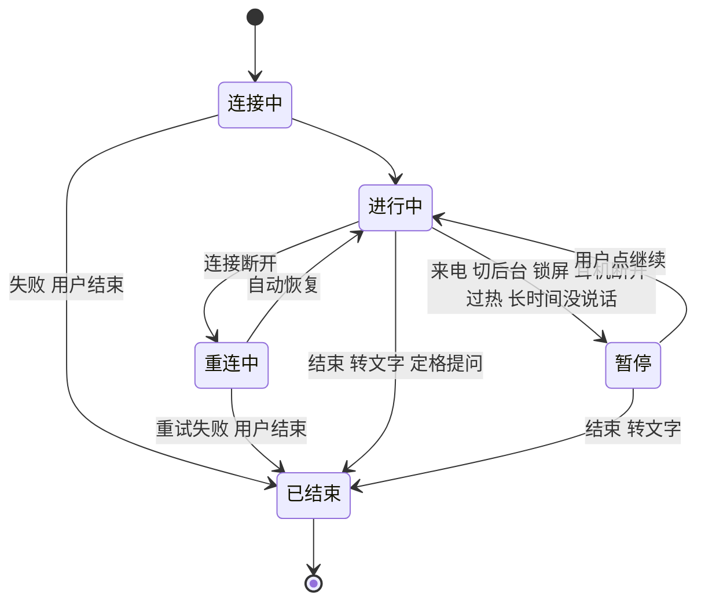

# 实时会话

实时会话是产品最核心、状态最多的部分。这份文档是它的行为规格，四端都按这里实现。

**实时是下阶段交付，Web 和 App 都一样。** 这里是预留设计，原型用 `stage=2` 或 `live` 参数打开。开工前先处理 [下阶段要对齐的事实](#下阶段要对齐的事实)，里面有几条和下面的规格不符。

## 模型

实时会话的状态拆成四条互相独立的轴。把它们混成一个状态枚举，组合会失控。

| 轴 | 取值 | 谁决定 |
|---|---|---|
| 生命周期 | 连接中、进行中、暂停、重连中、已结束 | 系统和用户 |
| 话轮 | 聆听、你在说、回应、主动提醒、重叠 | 模型和用户 |
| 通道 | 麦克风开关、画面开关、先听我说 | 用户 |
| 质量 | 正常、放慢、只用声音 | 设备和网络 |

## 话轮

状态灯和状态词是用户判断“它现在在干嘛”的唯一依据，同一时刻只有一个。

| 话轮 | 状态词 | 灯 | 波形 |
|---|---|---|---|
| 连接中 | 正在连接 | 琥珀，闪烁 | 无 |
| 聆听 | 聆听中 | 青瓷 | 上轨底噪 |
| 你在说 | 正在听你说 | 墨 | 上轨起伏 |
| 回应 | 正在回应 | 青瓷，外环 | 下轨起伏 |
| 主动提醒 | 主动提醒 | 青瓷，外环 | 下轨起伏，转写带标记 |
| 重叠 | 听到你了，先停下 | 墨，外环 | 两轨起伏，整列铺色 |
| 暂停 | 已暂停 | 琥珀 | 停止，变淡 |
| 重连中 | 正在重连 | 琥珀，闪烁 | 停止，变淡 |

麦克风关闭时，聆听状态词换成“麦克风已关”；先听我说时换成“先听你说”。

灯说的是话轮，有没有采集由时长前面的朱砂采集点回答。听或看任何一路在采集时它亮着，暂停、重连、麦克风关闭且没有画面时它消失。

## 通道

| 控制 | 行为 | 反馈 |
|---|---|---|
| 麦克风 | 模型听不到你，会话继续 | 按钮换划线图标和中性底色，写“已静音” |
| 画面 | 模型看不到，声音继续 | 取景框变细线，写“模型看不到画面” |
| 定格提问 | 结束实时，带上这一帧进入文字 | 回到输入框，提示可以回到实时 |
| 先听我说 | 模型立刻停下，只听不说 | 按钮高亮，状态词变化，转写标“已让它停下” |
| 转文字 | 结束实时，用文字继续 | 记录带入上下文，有画面时带上最后一帧 |
| 结束 | 结束实时 | 提示已结束，可以重新开始 |

运行中可以切换来源：语音加入画面，摄像头换屏幕。不用重新开始。

手机上屏幕共享要走系统选择器，第一版手机入口不提供，见 [平台落地](07-platforms.md)。

## 打断：暂停

暂停是用户没有主动选择的停止，由系统、环境或长时间没说话造成。规则：

1. **立刻停止采集**，模型正在说的话也停下，转写标“说到一半暂停了”。
2. **写明原因和事实**。原因说发生了什么，事实说它现在听不到也看不到。
3. **只有用户点继续才恢复**。原因消失时提示可以继续，不自动恢复。
4. **计时暂停**，时长只算真正在进行的时间。
5. **记录空白**：恢复后转写里留下一行“来电 · 暂停了 1 分 12 秒”。
6. **转文字和结束始终可用**。用户不必等原因消失。

| 原因 | 提示 | 能否立刻继续 |
|---|---|---|
| 来电 | 来电中，实时已暂停。麦克风交给了电话，它现在听不到也看不到。 | 通话结束后 |
| 离开应用 | 离开时已暂停。回来后写“回来了，要继续吗？” | 可以 |
| 按电源键锁屏 | 屏幕锁定了，已暂停。回来后写“回来了，要继续吗？” | 可以 |
| 耳机断开 | 耳机断开了，已暂停。回答不会突然外放，确认后再继续。 | 可以，按钮写“外放继续” |
| 过热 | 设备太热，已暂停。等它降温后再继续，通常要几分钟。 | 降温后 |
| 电量快用完 | 电量快用完了，已暂停。转写都在。接上电源更稳妥，现在继续也可以。 | 可以 |
| 长时间没说话 | 很久没听到声音，已暂停。它现在听不到也看不到，点继续后才会重新开始。 | 可以 |

耳机断开时暂停是隐私决定：回答可能涉及体检报告这类内容，不能突然从扬声器放出来。同样的规则用在所有“从私密变公开”的输出变化上，比如耳机换成车载音响。反过来从外放换到耳机不用暂停。

## 打断：重连

连接断开时，会话进入重连，不算暂停，因为恢复不需要用户决定，采集内容也不变。

- 提示“连接断了，正在重连”和尝试次数，写明到目前为止的记录都在。
- 恢复后留下空白：“连接中断 5 秒，这段时间没有听到”。
- 重试失败后结束会话，写“连接中断，已保留到此为止的转写”，输入框上方给出原因和重试。

## 打断：模型中断

模型停止响应但应用还在时，走重连的同一条路径，文案写“模型”。这段时间不采集，状态词是“正在重启”。

- 提示“模型停止响应，正在重启”和尝试次数，写明到目前为止的记录都在。
- 恢复后留下空白：“模型中断 5 秒，这段时间没有听到”。
- 重启失败后结束会话，写“模型中断，已保留到此为止的转写”，输入框上方给出原因和重试。
- 崩溃报告的处理见 [意外退出之后](#意外退出之后)。

## 质量下降

资源不够时分步下降，每一步都告诉用户。

| 等级 | 条件 | 变化 | 用户看到 |
|---|---|---|---|
| 正常 | | 每秒 1 帧 | “本机处理 · 每秒看 1 帧” |
| 放慢 | 设备偏热，或网络不稳 | 每 3 秒 1 帧（网络每 2 秒） | 标签更新，提示“设备有点热，看画面放慢了”，转写留一行 |
| 只用声音 | 设备很热 | 停止看画面，声音继续 | 取景模糊，写“设备太热，先只用声音” |
| 暂停 | 系统要求立刻降载 | 全部停止 | 见上节 |

降温后自动回到上一级，这一步可以自动，因为只是恢复原本同意过的采集范围。**暂停之后除外**，暂停后恢复永远要点击。

设置里“发热时降低负载”关闭后，跳过放慢，只保留暂停。

### 低电量

低电量走同一套阶梯，文案改成电量。发热和电量同时出现时，按更严重的一级走，同级时写发热。

| 等级 | 条件 | 用户看到 |
|---|---|---|
| 放慢 | 系统低电量模式开着，或电量不到 20% | “电量低，看画面放慢了” |
| 只用声音 | 电量不到 10% | “电量很低，先只用声音” |
| 暂停 | 电量不到 5% | “电量快用完了，已暂停” |

- 门槛是起点，要用实机数据调 **[待实测]**。在充电时不算。
- 接上电源后，前两级自动回到上一级，规则和降温相同。
- 电量暂停不是为了保护设备，所以随时可以点继续，继续后先只用声音。接上电源后写“接上电源了，要继续吗？”，继续后回到原来的范围。
- 语音实时没有画面可以放慢，前两级只改运行情况的文字，不留记录。发热同样处理。
- “低电量时自动省电”关闭后，跳过前两级，只保留暂停。没电关机比暂停更糟。

## 长时间没说话

避免用户忘记关闭摄像头和麦克风。设置里默认 10 分钟，可选 5、10、30 分钟或不自动暂停。

- 到时前 30 秒，控制条出现“没听到声音，30 秒后暂停”和“继续聊”。
- 用户说话或点继续聊，取消倒计时。
- 到时进入暂停，采集立刻停止，规则和其他暂停相同：要点继续才恢复，转写留下一行空白。
- 暂停不会自动变成结束。用户回来时会话还在，可以继续、转文字或结束。
- 暂停期间模型是否留在内存，由“空闲后释放内存”决定。释放后点继续要先重新载入。

## 屏幕

用户把手机放下接着聊是常见用法，比如在厨房。系统默认的息屏会让应用离开前台，触发“离开即暂停”，所以实时期间要管好屏幕。

- **保持屏幕亮着**：实时期间不自动息屏，默认开，可以在“设置 > 实时会话”关闭。关闭后息屏等于离开。
- **按电源键算离开**：用户主动锁屏就暂停，点继续才恢复。这是用户想要结束听和看的最直接动作。
- **长时间没说话**的规则继续有效，防止手机一直亮着听。
- 低电量模式下照常保持亮着，靠远看模式省电。发热等级不变。

### 远看模式

放远了也要看得清它在干什么。只用于紧凑形态的语音实时。

| 属性 | 规格 |
|---|---|
| 进入 | 15 秒没碰屏幕自动进入，或从“更多”进入。设置里可以关 |
| 画面 | 深色全屏，状态词放大到 34–46，状态灯放大 |
| 采集信号 | 整圈朱砂框和“本机处理 · 只用声音”标签，和摄像头实时相同 |
| 控制条 | 不变，结束按钮一直可点 |
| 退出 | 点屏幕回到记录，或从“更多”退出 |
| 暂停时 | 写暂停原因，和其他暂停相同 |

### 在车里

第一版不做车机应用。

- 手机连上车载音频时当作普通输出设备，规则同上：从耳机换到车载音响要暂停确认。
- 语音实时可以用，远看模式就是这时的界面。
- 不主动推荐摄像头，开车时不应该举着手机。
- 不检测是否在开车，也不因此改变功能。

## 声音输出

入口在紧凑形态的“更多”和展开形态的运行状态里，打开系统的输出选择。

外放时默认开回声消除，全双工下模型不能听到自己。

## 结束方式

| 方式 | 转写 | 后续 |
|---|---|---|
| 用户结束 | 保留 | 提示可重新开始 |
| 转文字 | 保留 | 输入框获得焦点，上下文带入，可回到实时 |
| 定格提问 | 保留 | 这一帧成为附件 |
| 连接失败 | 保留到中断时 | 写明原因 |
| 模型重启失败 | 保留到中断时 | 写明原因，输入框上方给重试 |
| 应用被系统回收或崩溃 | 保留到最后写入时 | 下次打开时写“上次实时会话意外结束”，不自动恢复 |

设置里关闭“保存实时转写”后，结束时只留一行时长记录，不留文字。

## 意外退出之后

应用被系统回收或崩溃后，下次打开时：

| 上次在做什么 | 打开后 | 动作 |
|---|---|---|
| 实时会话 | 回到那段对话，转写保留到最后写入时，横幅写“上次实时会话意外结束”和“现在没有在听” | 重新开始、知道了 |
| 回答 | 已写出的部分留着，下面写“模型中断了，回答到这里” | 接着写 |
| 载入模型 | 这次不自动载入，横幅写“上次载入时应用退出了”，可能是内存不够 | 再试一次、换模型 |

- 实时不自动恢复，和暂停同一条规则：没人看着时不重新开始听。
- 载入时退出后不再自动载入。模型太大时系统会直接结束应用，再自动载入就成了每次打开都崩溃。用户发送或点再试一次才载入。
- 模型中断但应用还在时，回答留在原处，写法相同。

**崩溃报告**按“隐私与数据”里的设置处理。默认每次询问：上面的提示处理完后，横幅问一次，写明只含设备型号、应用版本和出错的位置。发送后记进联网记录。离线模式下不问。选“自动发送”时不问，同样记进联网记录。

## 开始之前

模型不在内存里时，点实时先走“正在准备”，见 [信息架构](03-structure.md#正在准备)。这段时间不采集，也不出现朱砂，横幅写明“现在还没有在听”。

## 其他页面看实时

一次只有一个实时会话。用户去看别的对话或设置时：

- 顶部出现朱砂状态条：对话名、时长、返回、结束。暂停时换成琥珀，写“实时会话已暂停”。
- 其他对话可以看，不能发送，输入框上方说明原因。
- 手机上由系统级活动承担这个角色，见 [平台落地](07-platforms.md)。

## 主动提醒

模型每秒决定是否开口。客户端通过 `force_listen` 控制它能不能主动说话：

- 回答不受限制，已经开始的句子不会被打断。
- 用户刚说完的 4 秒内算回应，不算主动。
- 其他情况受冷却时间限制：克制 45 秒，积极 12 秒，关闭时不主动。

| 场景 | 默认频率 |
|---|---|
| 生活助手 | 克制 |
| 工作助手 | 克制 |
| 游戏助手 | 积极 |
| 社区助手 | 关 |

每条主动提醒旁有“少提醒”，点一次降一档，可撤销。运行状态里显示压住了几次。

## 引擎约束

这些约束来自 llama.cpp-omni 的协议，影响了上面的设计。引擎变化时回来检查。

| 约束 | 设计结果 |
|---|---|
| 全双工和轮流对话是两种会话，缓存不互通 | 转文字要结束实时，客户端重建上下文 |
| 全双工会话不能插入文字 | 实时中没有文字输入。这是已确认的范围决定 |
| 画面按帧上传 | 界面说“每秒看 1 帧”，不说“视频” |
| 一次只跑一个会话 | 全局只有一个实时会话 |
| 本机难以同时运行多个模型 | 模型是全局的，实时中不能换 |
| 轮流对话只保留最近 8 条，每条有长度上限，只取一张图 | 实时记录放进系统消息，最新的优先 |

## 下阶段要对齐的事实

读 `refs/minicpm-o-demo@47709a9` 得到。这是 Python 后端的行为，`llama.cpp-omni` 的 C++ 后端还要核对。下面的规格先不改，开工时一起定。

| 事实 | 依据 | 影响 |
|---|---|---|
| 听的时候没有你说的话的文字 | `core/schemas/duplex.py:422`，`py_backend/server.py:471` | 话轮记录里“你”的文字、转文字带上记录都没有数据来源。提议：基线只记模型一侧，你这一侧写“你说了 12 秒”，原生端可选本机识别。Web 不用浏览器语音识别，Chrome 的实现把音频发到服务器 |
| 话轮只有 listen 和 speak，约 1 秒一次 | `docs/audio-duplex-protocol.md:52` | “你在说”“重叠”只能靠客户端电平推断。“听到你了，先停下”承诺过头 |
| 语音打断不一定立刻生效 | `static/faq/zh/audio-duplex.md:7,11` | 可靠的打断是“先听我说”，要放到更显眼的位置 |
| KV 到上限自动停止，默认 8192 | `static/duplex/lib/realtime-session.js:611` | 要有“实时记忆快满”的提示和结束原因。视频约 95 token/秒，不滑窗约 86 秒到顶（推断），端侧表现 **[待实测]** |
| 远程有时长上限和暂停超时：视频 300 秒，音频 600 秒，暂停 60 秒 | `gateway.py:1408`，`config.example.json` | 和“暂停不会自动变成结束”冲突。远程要有单独的结束原因 |
| 远程有排队：位置、预计等待、取消 | `frontend/mobile/src/duplex/useDuplexSession.ts:319` | 缺一个生命周期状态 |
| 官方有用户主动暂停 | `AudioDuplexScreen.tsx:420` | 我们的暂停定义是“用户没有主动选择”，控制条没有暂停按钮 |
| 半双工：靠静音判断说完，不能打断，延迟低、更稳，官方把入口隐藏了 | `static/faq/zh/half-duplex.md`，`static/index.html:502` | 可以作为质量下降的一级，设备撑不住全双工时用 |
| 视频有预览态：摄像头开着，但没有发送 | `useDuplexSession.ts:423` | 朱砂规则要覆盖这一态 |
| 单次处理 1 秒音频要 0.5–0.9 秒（A100） | o-demo README | 余量很薄，可以加“跟不上”的质量信号（推断） |

## 运行位置和模型

实时会话进行中不能切换运行位置，也不能换模型，结束后才行。规则见 [信息架构](03-structure.md#运行位置)。

当前模型不能实时时，开始实时前先问要不要换，见 [当前模型](03-structure.md#当前模型)。

## 语音消息和语音回复

两者都不是实时：

- **语音消息**：录一段发送，和文字消息一样轮流。
- **语音回复**：回答同时朗读。

实时入口用波形图标，语音消息用麦克风图标，区分这两件事。
