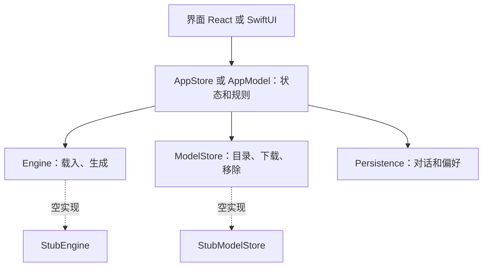

# 客户端架构

本文说明真实客户端（`apps/`）怎么组织，以及 Web 和 iOS 共用的推理接口。产品规则仍以 [信息架构](03-structure.md)、[状态矩阵](05-states.md) 和 [隐私设计](08-privacy.md) 为准，这里只写落地方式。

现阶段是初版骨架：界面和状态是真的，推理、下载、备份都是空实现。

## 仓库结构

| 路径 | 内容 |
|---|---|
| `index.html`、`docs/`、`tokens/` | 设计来源，继续作为规格 |
| `apps/web/` | 真实 Web 客户端：Vite、React、TypeScript |
| `apps/ios/` | 真实 iOS 客户端：SwiftUI，最低 iOS 27 |
| `tools/tokens.mjs` | 把 `tokens/` 同步到原型、`apps/web` 和 `apps/ios` |

两端都是三层，名字尽量相同，这样同一条规则能对着看：

规则层不依赖界面框架。Web 是 `apps/web/src/core`，iOS 是 `apps/ios/Packages/MiniCPMCore`，后者不引用 SwiftUI，规则用 `swift test` 单独测试。iOS 工程只在 macOS 上构建。

## 第一阶段的范围

只做 [交付阶段](03-structure.md#交付阶段和两条基线) 的第一阶段：看图模型、文字对话、图片和文件、拍照提问。实时、语音回复、全能模型不实现，入口按模型能力隐藏，不写“即将推出”。

数据结构现在就留好下阶段的位置：回答记下模型，对话条目是可扩展的联合类型，读到不认识的条目类型时跳过，不报错。

## 推理接口

一套语义，两种语言。Web 在 `apps/web/src/engine/types.ts`，iOS 在 `MiniCPMCore/Engine.swift`。

运行位置的两个选项是同一个 `Engine` 接口的两个实例。**规则层只由用户切换实例，失败时绝不自动换。**

### Engine

| 方法 | 含义 | 规则 |
|---|---|---|
| `probe()` | 这台设备能不能本机运行，内存和可用空间 | 打开时调用。读不到的值是空，不是 0 |
| `load(optionId, cancel)` | 载入一个已下载的模型 | 一次只有一个。载不下时抛 `outOfMemory`，由规则层换回原模型 |
| `unload()` | 释放内存 | 换模型时先释放再载入，空闲释放也走这里 |
| `prepareImage(file)` | 图片加进来就开始处理 | 返回不透明的句柄。发送早于处理完成时，规则层等它完成再调用 `generate` |
| `generate(request, cancel)` | 流式生成，产出 `GenerationEvent` | 取消后回答留在原处。一次只有一个 |

### GenerationEvent

| 事件 | 字段 | 界面 |
|---|---|---|
| `text` | `delta` | 追加到回答 |
| `memory` | `text` | 回答下一行“已记住”，可撤销 |
| `askSearch` | `query` | 联网询问卡片，点了才发 |
| `action` | `kind` `when` `text` | 定时通知或备忘录卡片 |
| `cut` | `reason` | “回答太长，到这里停了”，给接着写 |
| `done` | `tokensPerSecond` `seconds` | 记到回答上，打开“显示技术信息”后可见 |

`memory`、`askSearch`、`action` 由模型判断，所以放在事件里，不在界面里猜。

### GenerateRequest

`modelId`、`system`（人设和用得上的记忆）、`messages`（角色、文字、图片句柄）、`params`（高级设置里的参数，键名和引擎字段相同）、`thinking`、`highDetail`、`canRemember`（临时对话或记忆关着时为假，模型要回答自己记不下来）。

`messages` 是完整历史，放不下时由引擎截断。官方引擎只保留最近 8 条，见原型的 `buildFollowUp()`。

iOS 的 `probe()` 还多返回 `isResponding`，`ModelStore.download` 多一个 `allowsCellular`。这两项只有原生端用得到，Web 不实现。

### ModelStore

| 方法 | 含义 |
|---|---|
| `catalog(device)` | backend 读硬件后列出这台设备能选的模型，每一项是一个可下载的选择 |
| `installed()` | 已下载的选择。一个模型只留一种规格 |
| `download(optionId)` | 返回进度事件和暂停、继续、取消。状态同 [状态矩阵](05-states.md)：下载中、已暂停、等待 Wi-Fi、下载中断、校验中、文件不完整 |
| `remove(optionId)` | 删除文件 |

### 错误

`EngineError` 只有这几种：`unavailable`（跑不了或连不上）、`outOfMemory`、`network`、`notInstalled`。界面文案由规则层按错误选，引擎不写用户文案。

### 接入真实后端

- **Web**：实现 `Engine` 和 `ModelStore`，改 `apps/web/src/engine/index.ts` 里的一行。接口只传可序列化的数据和 `AbortSignal`，方便放进 Worker。模型文件放 OPFS，开始下载前调用 `navigator.storage.persist()`。开发服务器已带跨源隔离响应头（COOP、COEP），多线程 WebAssembly 要用。GitHub Pages 不能设响应头，部署时要换托管方式或用 Service Worker 补 **[待实测]**。
- **iOS**：实现同名协议，改 `AppModel` 的构造参数。官方的 `MTMDWrapper` 对应关系：`initialize` 对 `load`，`addImageInBackground` 对 `prepareImage`，`addTextInBackground` 加 `startGeneration` 对 `generate`，`stopGeneration` 对取消，`cleanup` 对 `unload`（`refs/minicpm-v-apps/MiniCPM-V-demo/MTMDWrapper/MTMDWrapper.swift@d0dd7a6`）。

## 空实现怎么表现

`StubEngine` 不跑模型，回一段写明“这是占位回答”的文字，流程上和真实引擎相同：载入有等待，生成是流式的，能取消。这样界面的每条路径现在就能走通，接上真实后端时界面不用改。

`memory`、`askSearch`、`action` 三种事件现在靠消息开头触发（“记住……”“查一下……”“每天……提醒我”），只为走通界面。真实模型自己判断。

## 备份、搜索和系统能力

备份、导出导入、联网搜索、定时通知现在只有入口和状态，点了提示还没接入。只有不改变隐私承诺的本地能力是真实的：复制、朗读、选文件、图片预览。

联网记录只写真实发生过的请求。联网搜索还没接入，所以点“查一下”后什么都不发送，也不留记录。

iOS 已经把这些能力收进 `MiniCPMCore/Services.swift` 的协议，规则写在 `AppModel`，实现通过 `AppServices` 传入。未接入的实现抛 `notConnected`，规则层把它变成“这项还没接入”，不改任何状态，也不锁定应用。协议清单见 [iOS 客户端说明](../apps/ios/README.md#接入系统服务)。Web 还没有对应的接口，接入时用同样的名字。

## 第一版还没移植的

对照原图、回答产物和思考过程、崩溃报告询问、Web 的离线缓存（PWA）、字符串抽取（四语）、界面语言和文字大小的实际效果。这些设计都在原型里，接入后端时再移植。
