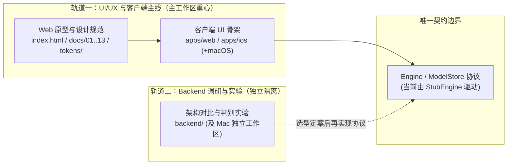

# 项目路线与双轨分工

更新于 2026-11-14。已定事项记在 [决策记录](10-decisions.md)，本文明确当前工作区的双轨收敛结构、Apple 双端（macOS、iOS）的 UI/UX 主线，以及独立 Backend 实验轨道的边界。

## 目标与当前状态

从 OpenBMB 社区出发，以可用的跨端 App 展示并推进 **LES 为主的端侧推理效能**，证明大模型在端侧可以做得很好，并产出可复现、可分享的技术成果。

- **技术取向：** 主动探索新技术。以性能、能效、能力突破、社区贡献与维护成本判断投入，不以最快产出产品为首要目标。
- **应用价值：** 隐私优先的真实使用场景是 App 的需求基础，让端侧能力有用。界面就近披露速度、内存等测量，允许调整计算参数，但分层披露、默认开箱即用，见 [设计思想](01-philosophy.md#2-参数看得见调得动但不堆在面前)。
- **设计范围：** 覆盖 Web、Desktop、Mobile 三大形态（iOS / iPadOS、Android、macOS、Windows、Linux、Web；其中 Windows 和 Linux 当前主要由 Web 交付）。
- **当前重心：** 下一步只做 **macOS、iOS App**，按能上架 App Store 来设计和规划（见 [开发期合规](12-compliance.md)、[首次发布](13-release-and-store-policy.md)）。Android、Windows、Linux、Web 暂停：已有设计和代码保留，不再同步更新，重启时再对齐。`index.html` 原型继续作为结构、状态和文案的规格；视觉风格以 Apple 端为准，见 [设计语言](02-design-language.md)。端侧推理 Backend 的选型与实验继续解耦至独立轨道。
- **代码现状：** 网页原型（`index.html`）与客户端骨架（`apps/web`、`apps/ios`）服务于 UI/UX 验证与跨端交互落地；推理与模型下载通过 [`Engine` / `ModelStore`](11-client-architecture.md#推理接口) 空实现驱动，计算后端尚未选定。

现有产品规则继续适用：端侧优先、无付费功能与追踪、在线备用默认关闭且需同意、失败不自动改变运行位置。第一阶段保留看图与文字范围，实时与全能能力继续留在下阶段设计中。开发期免费签名与首次发布前的事项按 [开发期合规](12-compliance.md)、[首次发布](13-release-and-store-policy.md) 执行。

## 双轨解耦：UI/UX 主线与 Backend 实验分离

为避免底层推理实验与跨端产品设计相互阻塞，仓库工作划分为两条通过契约边界隔离的轨道：

| 轨道 | 负责范围 | 存放位置 | 协作与隔离规则 |
|---|---|---|---|
| **轨道一：UI/UX 与客户端主线（当前重心）** | 只推进 **macOS、iOS** 原生端的界面形态、主题与视觉风格、状态闭环、平台原生控件映射与第一阶段未完项，按 App Store 上架要求规划；其他平台暂停 | `index.html`、`states.html`、`tokens/`、`docs/01`–`docs/13`、`apps/` | 独立演进，不等待真实后端；所有推理与资产交互统一通过 `StubEngine` / `StubModelStore` 验证 |
| **轨道二：Backend 调研与实验（独立轨道）** | iOS / Apple 端侧推理架构对比、LES 调度评估、Core AI 导出与算子判别实验（E1–E3），以及跨端技术评估（含 WebGPU 调研归档） | [`backend/`](../backend/README.md) 及远端 Mac `~/workspace/minicpm-coreai` | 实验脚本、配方与调研报告不混入主 `docs/` 序列；选型定案前不修改 `apps/` 正式代码 |

## 轨道一（当前主线）：macOS / iOS App（其他平台暂停）

现阶段只推进 **macOS、iOS**，按上架 App Store 规划，同时保留 `index.html` 原型用于交互验证：

1. **推进范围：**
   - **iOS / iPadOS（Mobile & Tablet）：** `apps/ios` 在紧凑（iPhone）与展开（iPad）形态下的 Liquid Glass 原生交互、模拟器未走查项与第一阶段视觉/设置状态补齐。
   - **macOS（Desktop）：** 在 `apps/macos/` 下拆分为独立工程，复用 `MiniCPMCore`（已声明 `macOS 27.0`），落地桌面专属交互（`NavigationSplitView` + `.inspector`、独立 `Settings` 场景、菜单栏与快捷键、窗口尺寸自适应等，见 [平台落地](07-platforms.md#macos-特有)）。
   - **视觉风格与主题：** 方向和主题集见 [设计语言](02-design-language.md)，色值在 `tokens/`，由 `tools/tokens.mjs` 生成 Asset Catalog。
   - **暂停：** Android、Windows、Linux 和 Web。Web 经 [WebGPU 调研评估](../backend/webgpu-browser-assessment.md) 暂缓；`index.html` 与 `apps/web` 既有骨架保留，不随新设计同步。
2. **规格先行与同步：** 交互行为、状态与文案变更先落入原型与 `docs/01`–`docs/11`，并在推进 `MiniCPMCore` 时保持与既有规则边界一致（未来重启 Web 端后再对齐 `apps/web/src/core`）。

## 轨道二（独立轨道）：Backend 选型原则与实验入口

推理后端选型在 [`backend/`](../backend/README.md) 独立推进，遵循以下架构分层与比较原则：

| 层次 | 选型要回答的问题 |
|---|---|
| App 与会话 | Swift UI、产品规则、流式输出、取消与系统会话接口如何衔接？ |
| 推理运行时 | 谁负责模型执行、状态缓存、采样、prefill 与 decode？ |
| LES 调度 | 谁负责专家缓存、闪存读取、预取、就绪优先与投机验证？ |
| 计算 | CPU、GPU、ANE 各执行哪些部分，通过什么算子与同步机制协作？ |
| 模型资产 | 权重如何转换、量化、组织、分发与加载，是否沿用社区格式？ |

三条候选路线（**社区 LES 深度演进**、**Apple 平台混合实现**、**Core AI 中心实现**）按正确性、端侧效能、技术与社区成果、平台能力、工程可持续性及发布可行性六个维度评估，不预设赢家：

| 阶段 | 工作与产出 | 状态与入口 |
|---|---|---|
| A：架构认知与路线对比 | 核实社区调用链与 Apple 能力边界，将分歧收敛为 E1–E3 | 已交付：[`backend/ios-inference-options.md`](../backend/ios-inference-options.md) |
| B：基线与关键实验 | E1 已完成 Mac 1B 导出、动态专家 / 展开状态对照与 iOS 27.2 小图编译；后续推进真机验证与 E2 LES 基线 | 独立进行中：[`backend/coreai-export-experiment.md`](../backend/coreai-export-experiment.md)、[`backend/coreai/`](../backend/coreai/README.md) **[待实测]** |
| C：首个真实推理闭环 | 路线确认后写回 [决策记录](10-decisions.md)，更新 [客户端架构](11-client-architecture.md) 并接入 `Engine` | 待阶段 B 收敛后启动 |
| D：成果深化与发布 | 推进 LES / 平台优化、可靠性与全球 App Store 发布准备 | 后续阶段 |

## 当前边界与暂缓事项

- **不混入未定案后端：** 选型闭环前，不在 `apps/` 中接入实验性 Core AI 或 C++ 引擎，也不预建庞大的通用后端插件框架。
- **保持阶段一能力边界：** 实时会话、语音回复与全能模型继续作为下阶段预留设计（原型中通过 `?stage=2` 查看），第一阶段客户端隐藏相关入口。
- **延后商业化与国区上架：** 付费开发者注册、TestFlight、正式提审与中国大陆上架准备继续留到首次发布前处理。

## 文档关系

- [设计思想](01-philosophy.md)：项目使命与面向用户的体验原则。
- [平台落地](07-platforms.md)：iOS / iPadOS、macOS 的控件映射与平台差异；Android 和 Web 部分暂停更新。
- [决策记录](10-decisions.md)：已定方向、历史变化与待定事项。
- [客户端架构](11-client-architecture.md)：`apps/` 代码分层与 `Engine` / `ModelStore` 接入边界。
- [推理后端调研与实验索引](../backend/README.md)：独立 Backend 轨道的全部调研、路线对比与实验记录。
